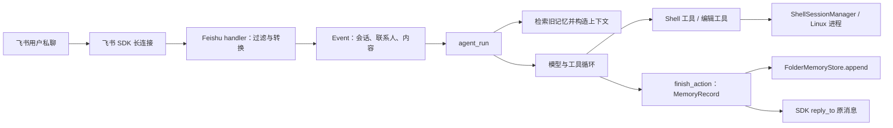

# Kapybara × 飞书：六天源码教学教案

> 制定日期：2026-10-14。教学对象：已经跑通 Docker 和飞书私聊回复、希望在 AI 应用开发面试中准确讲解这个项目的学习者。建议每天 3–4 小时，共六天；时间不足时使用文末的五天压缩方案。

## 一、这门课最终要达到什么程度

六天结束时，学习者应能离开代码完成以下四件事：

1. **从开发者视角复原核心设计顺序**：为什么先建立 Python 包与可控的 Linux 环境，再做可持续的 shell 会话、工具接口、Agent、记忆，最后连接聊天平台。
2. **画出飞书版完整调用链**：飞书事件 → 准入过滤 → `Event` → `agent_run` → 模型与工具循环 → `MemoryRecord` → 持久化 → 飞书回复；并能指出每一步对应的函数或文件。
3. **解释三个有深度的问题**：BashSession 如何处理长运行/交互命令及资源清理；Agent 如何组织工具、上下文和结束动作；记忆如何按会话与联系人被保存和检索。
4. **诚实地进行面试陈述**：分清上游已有核心、我们完成的飞书二次开发、代码已实现的能力，以及没有验证过的能力。能够回答 2 分钟概述、5 分钟深入讲解和故障追问。

这是一门**源码理解与表达课**。每天由讲解者提供一份可复习的源码讲解与调用图；学习者可以在过程中随时打断、追问或要求重讲，不需要接受课堂提问或当场测验。

## 二、代码边界、证据规则与授课方式

### 2.1 固定范围

- **历史主线**：从 `31aa577` 建包到 `48302f2` 形成可运行核心。只抽取与包、Docker、Shell、工具、Agent、记忆有关的提交。`48302f2` 中的 Telegram 内容只用于确认早期端到端集成，不作为讲解对象；随后的 `a5782f5` Telegram 修复也不作为必读。
- **当前实现**：以仓库当前工作区为准，重点看 `core/`、`shell-session-manager/src/shell_session_manager/session.py`、`collections/src/kapy_collections/starters/feishu/`、相关 Docker 文件及测试。
- **后期结构性变化**：只按需要理解当前 `Event.in_channel`、`Event.contacts`、`finish_action`、记忆自动检索和 `collections` 包的位置。无需逐条学习六个后期提交的完整 diff。
- **隔离与运行生命周期**：结合早期只读挂载提交 `c414ebc` 与当前 Compose、入口脚本和 Agent 代码，讲清容器边界、宿主机挂载、运行身份、Shell 会话、单次 Agent run、常驻消息入口和文件记忆。只描述配置和源码能证明的隔离能力，不把“运行在容器内”直接等同于完整安全沙箱。
- **暂不深入**：Telegram 的收发实现、`shellctl` 服务与数据库、邮件/群聊/媒体能力、复杂调度、后续性能优化、完整的提示词逐句分析。它们可能是实际功能，排除只是因为六天目标有限。

### 2.2 历史代码与当前代码不可混讲

历史提交中的模型、字段、路径、进程管理方式可能已经改变。每次授课都在笔记中标记：

| 标记 | 含义 | 例子 |
| --- | --- | --- |
| H | 历史设计，用来解释开发动机与演进 | `fbe15ae` 使用 `bus.jsonl` 轮询外部事件 |
| C | 当前代码，决定飞书版真实行为 | 飞书 SDK 长连接触发 `make_message_handler` |
| I | 依据代码作出的设计推断 | “作者可能是为了解决跨工具调用保留进程” |

不能把 H 直接说成 C，也不能把 I 说成作者明确表达的意图。当前飞书代码仍是**工作区本地改动，尚非上游已提交的历史节点**；面试时必须说明这一点。

### 2.3 安全查看历史，不切换工作区

仓库当前有未提交的飞书及相关改动。授课只用只读 Git 命令查看旧版：

```powershell
git show --stat 0b7aecb
git show 0b7aecb:core/src/k/io_helpers/bash_helper.py
git diff ff788e3^ ff788e3 -- core/src/k/agent/main.py
```

不要为授课执行 `git checkout`、`git reset`、`git clean`。每次开课先运行 `git status --short` 和 `git rev-parse --short HEAD`，确认当前代码是否变动；如果变动，重新核对教案中的当前路径与行为。

### 2.4 每天固定的教学循环

1. **直接讲开发动机**（约 15 分钟）：先说明当时要解决的工程问题、可选实现与该提交的选择，不要求学习者预先猜设计。
2. **沿源码讲实现**（约 2 小时）：先读文件和函数注释，再顺着状态、参数、返回值、副作用讲清调用链；遇到异步、Docker 或框架概念时立即补足必要背景。
3. **由讲解者演示真实场景**（约 45 分钟）：沿函数调用画箭头，明确宿主机、容器、SDK、模型和文件系统各承担哪一步，并展示一个失败分支。
4. **给出整理好的复盘**（约 30 分钟）：讲解者总结“为什么这样设计—代码怎么实现—有什么边界—面试如何表达”，附一张调用图和相关源码位置。学习者可按需追问；默认不进行提问、抽查、闭卷复述或当场评分。
5. **保留可选自查材料**：课后提供练习场景与参考思路，供学习者自行使用；不以是否完成练习决定下一天能否继续。

讲解者应先把“为什么”和“怎样做”讲完整，再给出可选练习。不得仅逐行朗读源码；也不得因进度压力略过 BashSession、Agent 循环和记忆三个核心主题。只有学习者主动提出时，才进行模拟面试或口头测验。

### 2.5 六天节奏与课前准备

| 天数 | 时长参考 | 本日讲解重点 | 讲解者提供的复盘材料 |
| --- | --- | --- | --- |
| 第 1 天 | 3 小时 | Python 包、Docker、Linux 运行身份与隔离边界 | 宿主机/容器/挂载/进程路径图 |
| 第 2 天 | 4 小时 | 长命令与交互程序的跨调用运行 | BashSession 状态图与 `next` 伪代码 |
| 第 3 天 | 3–4 小时 | 多个 shell 会话进入 Agent 工具的过程 | 工具到 Linux 进程的分层图 |
| 第 4 天 | 4 小时 | 模型与工具循环及结束动作 | 两层循环图与一次调用时序 |
| 第 5 天 | 4 小时 | 上一轮记录的保存和检索 | 记忆流转图与找不到记忆的排查表 |
| 第 6 天 | 4 小时 | 飞书接入、回复与排障 | 端到端白板图和两档面试讲解 |

每次授课前，讲解者先查看上一天的复盘材料、当天列出的文件及其注释、当前 `git status`。如源码变化导致教案与当前行为冲突，以代码为准，在复盘材料中写下差异后继续。日内时间建议按“开发动机 15 分钟—源码讲解约 2 小时—案例演示约 45 分钟—总结约 30 分钟”分配；第 2、4、5、6 天可把源码时间再延长半小时。

## 三、全局运行图与术语



注意两个经常混淆的“循环”：**一次任务内部**是 Pydantic AI 驱动模型与工具反复交互；**多条外部消息之间**，当前飞书版由 SDK 长连接不断触发消息回调。早期的 `bus.jsonl` 轮询属于后一层的历史原型。

讲“持久化运行”时分清五种寿命：容器服务可按 Compose 策略重启，但重启会重新建立进程；飞书 SDK 连接在服务进程运行期间接收多条消息；一次 `agent_run` 只处理一轮输入；`ShellSessionManager` 管的子进程可跨同一轮的多次工具调用，但结束这一轮时应清理；写入宿主机挂载目录的记忆文件可供后续轮次读取。授课时逐项核对当前源码与配置，不把 Shell 会话说成跨容器重启存活。

基础术语只在需要时引入：`async/await`（等待 I/O 时让出执行机会）、子进程与 stdin/stdout/stderr（程序输入与两路输出）、Session（保持一个进程的状态）、Manager（按 ID 管多个 Session）、Agent 工具（模型可调用的受控函数）、`Event`（平台消息的统一输入）、`MemoryRecord`（一次运行的可持久化结果）。

---

## 第 1 天：建包、依赖、Docker 与隔离边界

**建议时长：3 小时。讲解重点：Python 包为何先出现，Agent 实际在哪里执行，容器对文件和进程提供了什么边界。**

### A. 课前要看的代码

| 顺序 | 历史/当前 | 代码与定位 | 讲解者需要说明的内容 |
| --- | --- | --- | --- |
| 1 | H | `git show 31aa577:core/pyproject.toml` | 初始包的依赖、开发工具与尚未实现的业务功能 |
| 2 | C | [`core/pyproject.toml`](../../core/pyproject.toml)、[`collections/pyproject.toml`](../../collections/pyproject.toml) | 核心包与入口包的分工，以及 `kapy` 命令到 Python 函数的映射 |
| 3 | H | `git show 09e942f:Dockerfile`、`git show 09e942f:docker-entrypoint.sh` | 第一版镜像和入口脚本解决的运行环境问题 |
| 4 | C | [`docker/basic-os/Dockerfile`](../../docker/basic-os/Dockerfile)、[`docker/docker-compose.yaml`](../../docker/docker-compose.yaml) | 镜像中安装的包，以及 `/home/k`、`/core`、`/collections` 的来源 |
| 5 | C | [`docker/basic-os/docker-entrypoint.sh`](../../docker/basic-os/docker-entrypoint.sh)、[`supervisord.conf`](../../docker/basic-os/supervisord.conf)、[`data/fs/start.feishu.example.sh`](../../data/fs/start.feishu.example.sh)、[`core/src/k/config.py`](../../core/src/k/config.py) | 飞书进程的启动路径，以及 `PUID/PGID`、`K_CONFIG_BASE` 的作用 |
| 6 | H | `git show c414ebc:docker/docker-compose.env.yaml` | 早期把 `.kapybara` 配置目录以 `:ro` 方式挂入容器；说明只读挂载的对象和范围 |

### B. 讲解顺序

1. **从空包开始反推**：`31aa577` 的 `project-k` 主要是依赖、Python 版本与开发配置。说明建包是为了让代码可导入、依赖可管理、测试可运行；不能从这个提交声称 Agent 功能已经存在。最早依赖有 Pydantic AI、Pydantic、配置与日志相关包。此时还没有 BashSession 的 AnyIO 依赖，后续按需要加入。
2. **区分依赖的职责**：Pydantic AI 是模型/工具运行框架；Pydantic 验证数据；AnyIO 服务于异步进程与流；Logfire 用于观测。讲清每项依赖解决的问题，不要求学习者背版本号。
3. **从镜像到进程**：提交顺序实际是 `31aa577` 项目骨架 → `0b7aecb` BashSession 原型 → `09e942f` 第一版镜像 → `27b2200` Supervisor/SSH/cron。今天先看镜像，明天回头精读 BashSession，不把教学顺序误说成提交顺序。Dockerfile 定义运行环境；Compose 定义如何构建/运行和挂载；entrypoint 做容器初始化；Supervisor 管常驻进程；`/home/k/start.sh` 才启动飞书入口。历史第一版进程管理与当前 Supervisor 配置也并不相同。
4. **落实到本机**：当前 Compose 把 `data/fs` 挂到 `/home/k`，源码目录挂到 `/core`、`/collections`。`K_CONFIG_BASE=/home/k/.kapybara` 指向包含 `config.toml` 的目录；这能解释“默认去 `/root/.kapybara` 找不到配置”的旧问题。
5. **运行位置结论**：模型调用和工具编排的 Python 进程在容器内运行；模型服务可能在外部 API；Shell 工具访问的是它配置的 Linux 执行环境。不能笼统说“Agent 在飞书云端运行”。
6. **隔离边界与 Linux 身份**：`c414ebc` 的历史 Compose 对 `.kapybara` 使用 `:ro`，只代表该挂载在当时是只读的；当前 [`docker/docker-compose.yaml`](../../docker/docker-compose.yaml) 挂载 `data/fs`、`core`、`collections`，需分别核对其读写方式和持久性。当前入口脚本要求非零 `PUID/PGID`，先以 root 完成用户和服务初始化，再由 Supervisor 管服务；结合实际进程配置说明谁以什么身份执行命令。Docker 隔离、挂载权限、进程用户与模型可调用的 Shell 工具是不同层面的控制，不把其中任一层说成已证明的完整安全沙箱。

### C. 讲解者演示与可选自查

- **路径表演示**：讲解者写出宿主机 `data/fs`、`core`、`collections` 对应的容器路径，以及哪部分在容器重建后仍保留。`data/fs` 是持久数据挂载；源码挂载让容器看到本地改动。
- **配置故障演示**：对 `Expected config file at /root/.kapybara/config.toml`，依次定位 `K_CONFIG_BASE`、运行用户/HOME、`/home/k` 挂载和入口命令，说明它属于配置定位故障。
- **隔离边界演示**：列出当前 Compose 的每个挂载及读写范围，对照 `c414ebc` 的历史只读挂载；再从入口脚本追踪 root 初始化到运行用户和服务进程，不推断未经验证的网络、内核或容器逃逸防护。
- **可选自查**：学习者日后可尝试用 90 秒说明“包、镜像、容器、挂载、进程”的关系，不在课堂要求当场回答。

### D. 本日复盘材料与常见误区

讲解者交付：Windows 工作区 → Docker 挂载 → Linux 路径与运行身份 → `start.sh` → 飞书 Python 进程的图；另附“历史只读挂载与当前挂载的区别”和“为什么项目先建包和镜像”的简短解释。

误区：把 Dockerfile 当作每次消息的执行脚本；把 `core` 和 `collections` 当作两个独立 Agent；把第三方模型 API 与容器内 Agent 进程混为一谈。

---

## 第 2 天：BashSession 的设计与异步进程 I/O

**建议时长：4 小时。讲解重点：一次 `subprocess.run()` 为何不足以支撑 Agent 的交互命令。**

### A. 课前要看的代码

精读 `git show 0b7aecb:core/src/k/io_helpers/bash_helper.py`。优先顺序：`BashSession` 字段与 `NextResult` → `__post_init__` → `_ensure_started` → `_pump` → `next` → `_drain_output` → `_apply_event` → `interrupt`。对照该提交的 `core/tests/test_bash_helper.py`。当前文件已迁移，学习原始设计时不要先跳进今天更大的 [`shell-session-manager/session.py`](../../shell-session-manager/src/shell_session_manager/session.py)。

### B. 逐段讲解提纲

1. **先界定需求**：交互程序可能先输出提示，再等待 stdin；长任务可能在一次模型工具调用结束后仍继续运行；stdout 与 stderr 必须持续被读取。这三点决定 Session 是有状态的。
2. **状态模型**：解释 `_process`、三根管道、`_out_send/_out_recv`、`_stdout_done/_stderr_done`、`_closed`。`NextResult = (stdout, stderr, returncode)`；`returncode=None` 的意思是还未退出，不等于失败。
3. **启动**：`anyio.open_process()` 启进程，拿三根管道。历史第一版用 AnyIO task group 启两个 `_pump` 任务；说明为什么在中途初始化失败时也要尝试清理。
4. **后台读取**：每个 `_pump` 独立读一条输出流并投递到内存队列。模型没有调用 `next` 的间隙，后台仍要读；否则子进程输出可能堵住。`_StreamDone` 标记每条流结束。
5. **一次 `next` 的完整路径**：可选地写 stdin；从队列取已有输出；必要时短暂等待新事件；在超时或退出时返回。超时只结束本次等待，Session 可以留给下次 `next`。
6. **清理**：`interrupt` 幂等；先 terminate，必要时 kill；回收读取任务与进程。讲清为何取消、异常和部分初始化都必须考虑。`__del__` 只作尽力补救，不能替代显式清理。
7. **历史与当前的区别**：到 `014b2ed` 时实现改用更适合跨工具调用任务作用域的方式管理读取任务；深入原因放第 3 天。不要把 0b7 的任务组实现描述为当前实现。

### C. 手推场景

| 场景 | 要追踪的状态 | 正确结论 |
| --- | --- | --- |
| 命令立即输出并退出 | 两个 pump、队列、退出码 | 最后还要排空尾部输出 |
| 命令输出一行后等待输入 | `next` 首次返回、第二次写 stdin | 同一个进程跨调用保留 |
| 长命令暂时没有输出 | 等待超时、`returncode` | `None` 表示还在运行，可继续 `next` |
| 用户要求中止 | `interrupt` | 进程和后台读任务都应清理 |

课堂可在隔离的临时目录做一个**只读、无外部服务**的小实验，例如运行等待标准输入的 Python 程序，观察“先返回 `None`，再输入并结束”。若本机依赖未装好，就以仓库测试和状态推演完成，不让环境问题占满这一天。

### D. 本日复盘材料与可选自查

讲解者交付：一张包含“子进程—stdout/stderr 读取任务—内存队列—`next()` 调用者”的数据流图；一份 `next()` 与 `interrupt()` 的伪代码；一段可以用于面试的 2 分钟解释范例。

可选自查材料附参考思路：只读 stdout、不读 stderr 的风险；超时与 kill 的区别；关闭 Session 后再调用 `next` 的行为。课堂默认由讲解者说明答案，不要求学习者回答后才能进入第 3 天。

---

## 第 3 天：SessionManager、运行命令包装与 Agent 工具

**建议时长：3–4 小时。讲解重点：Session、Manager 和工具层为何分开。**

### A. 课前要看的代码

历史：`git show 014b2ed:core/src/k/io_helpers/shell.py`，重点是 `ShellSessionManager.new_shell/next/interrupt/close/list_sessions` 与 `ShellSession` 的生命周期。再看 `git show ff788e3:core/src/k/agent/main.py` 中四个 Bash 工具的最初接法。

当前：[`shell-session-manager/session.py`](../../shell-session-manager/src/shell_session_manager/session.py) 的 `ShellSessionManager` 和 `ShellSession`；[`BasicOSHelper`](../../core/src/k/runner_helpers/basic_os.py) 的 `command()`；[`shell_tools.py`](../../core/src/k/agent/core/shell_tools.py) 的 `bash`、`bash_input`、`bash_wait`、`bash_interrupt`、`edit_file`。只看这条调用链，不进入后期 `shellctl` 子系统。

### B. 讲解顺序

1. **从问题反推 Manager**：一次模型调用启动的进程可能尚未结束；下一次模型调用只能拿到 `session_id`，因此需要映射 `session_id → ShellSession`。Manager 负责注册、查找、上限、失效会话清理和集中关闭。
2. **并发边界**：历史 Manager 使用锁串行操作，限制活动会话数量；这是用简单不变量控制资源的选择。核对锁包住哪些操作，再讨论并发吞吐与正确性的取舍。不要说它已经提供分布式会话能力。
3. **跨工具调用的异步任务问题**：`014b2ed` 的模块注释说明，Session 要活过多次工具调用，而调用可能运行在不同任务中；早期 AnyIO task group 的作用域不适合直接跨越这些任务。用一张“第一次工具调用启动读取任务，第二次工具调用继续等待”的图解释修改原因。
4. **命令包装**：`BasicOSHelper.command(text)` 构造本地 PTY 或 SSH 命令，并统一进入 `bash -lc`、设置/读取 `K_CONFIG_BASE`。它是**执行方式适配**，不是模型工具本身。
5. **工具返回契约**：`bash` 新建会话，`bash_input` 送 stdin，`bash_wait` 等输出，`bash_interrupt` 停止；结果变为含 `session_id`、stdout、stderr、exit code 的 `BashEvent`。模型通过这个事件决定下一步。
6. **文件编辑工具**：`edit_file` 以已有 Bash 执行路径调用编辑脚本，并传入期望的旧内容；解释“核对旧内容再替换”的并发/误改意义。当天只读调用边界，不逐行讲编辑脚本。

### C. 场景演示与本日复盘

讲解者手推 `bash("sleep 3; echo done") → bash_wait(session_id) → BashEvent`，逐步标出模型、工具函数、Manager、Session、操作系统各承担哪一步。接着演示未知 `session_id` 和进程仍运行但输出为空的处理，给出对应源码依据。

讲解者交付：分层图（工具接口 / 命令包装 / 会话管理 / 子进程）和“为什么 BashSessionManager 是必要的”的 2 分钟表述范例。

---

## 第 4 天：Agent 构成、两层循环与结束动作

**建议时长：4 小时。讲解重点：工具接入后，谁决定继续、何时结束，以及结束时返回什么。**

### A. 课前要看的代码

历史依次读：`git show ff788e3:core/src/k/agent/main.py`；`git show bde0d27:core/src/k/agent/main.py` 中 `MyDeps` 生命周期；`git show fbe15ae:core/src/k/agent/init_agent.py` 中 `Agent`、`handoff`、`claim_read_and_empty`、`main`；`git show 48302f2:core/src/k/agent/core/agent.py` 看首次整理后的核心。

当前读 [`agent.py`](../../core/src/k/agent/core/agent.py) 的 `MyDeps`、`finish_action`、`Agent(...)`、`agent_run`；[`entities.py`](../../core/src/k/agent/core/entities.py) 的 `Event`；[`runtime_prompting.py`](../../core/src/k/agent/core/runtime_prompting.py) 的运行时提示组装。提示词只看哪些信息被注入，不要求背全文。

### B. 讲解顺序

1. **第一版 Agent**：`ff788e3` 用 Pydantic AI `Agent` 注册 Bash 工具，`RunContext[MyDeps]` 让工具访问 Manager 和配置。说明“Agent 的推理/工具往返”由 Pydantic AI 执行；项目负责工具、上下文、输入输出协议。
2. **资源所有权**：`MyDeps` 在一次运行内拥有 ShellSessionManager；使用 `async with` 或 `finally` 清理。讨论模型报错、用户中止后如果不关闭 Manager，子进程可能怎样残留。
3. **早期外层事件循环**：`fbe15ae` 从 `bus.jsonl` 读取事件，对 instruct 启动一次 Agent run，再写回 response/stuck；这是历史原型。它与一次 Agent run 内模型反复调工具的循环不同。当前飞书 SDK 回调替代了这一外层消息入口。
4. **结束动作演进**：早期有 `finish`/`handoff`；当前用 `ToolOutput(finish_action)` 让模型产出 `MemoryRecord`。`raw_output` 是交给飞书适配器发送的用户可见文本，其他字段记录本轮的输入、意图和行动摘要。只讲当前契约，不追完所有 compactor 重构 diff。
5. **当前 `agent_run`**：先准备记忆与联系人上下文，创建 `MyDeps`，组织系统/事件/用户内容，调用 `agent.run()`，然后补全运行记录。`agent_run` 返回可持久化记录；飞书入口才负责保存和发送。
6. **请求上限与失败**：当前代码用 `UsageLimits()`；模型多次请求但未结束可能耗尽预算。区分“模型内部达到上限”“Agent 运行抛异常”“飞书回复 API 失败”，三者排查位置不同。

### C. 调用图与面试表达范例

讲解者画出两层循环并沿一次调用走完：当前飞书收到第二条消息，会重新调用 `agent_run`；同一次 `agent_run` 内可以多次调用 Bash 工具；`finish_action` 结束的是一次 Agent run。接着说明为什么 `finish_action` 返回的是记录，而飞书用户看到的是 `record.output`。

面试表达范例应覆盖“Agent loop 哪些由 Pydantic AI 提供，哪些由项目代码实现”，避免夸大。学习者主动要求模拟面试时，再用这个问题提问。

---

## 第 5 天：记忆数据模型、存储与自动检索

**建议时长：4 小时。讲解重点：上一轮记录如何保存、检索，以及为何可能找不到。**

### A. 课前要看的代码

历史：`git show 170d779:core/src/k/agent/memory/entities.py`、`git show 170d779:core/src/k/agent/memory/simple.py` 的公开接口、`git show 1e5c8be:core/src/k/agent/memory/store.py`、`git show 1e5c8be:core/src/k/agent/memory/folder.py` 的主要方法。重点是概念和调用，不读完数百行实现细节。

当前：[`MemoryRecord`](../../core/src/k/agent/memory/entities.py)、[`MemoryStore`](../../core/src/k/agent/memory/store.py)、[`FolderMemoryStore`](../../core/src/k/agent/memory/folder.py) 的 `get_latests/get_by_id/append`、[`memory_injection.py`](../../core/src/k/agent/core/memory_injection.py) 的 `prepare_memory_run_state`、`build_memory_injection_context`、`build_finish_action_record`、[`by_in_channel.py`](../../core/src/k/agent/memory/retrieval/by_in_channel.py)、[`by_contact.py`](../../core/src/k/agent/memory/retrieval/by_contact.py)。若需确认语义，可参考 [`channel.md`](../concept/channel.md) 和 [`contacts.md`](../concept/contacts.md)，但以当前代码为准。

### B. 讲解顺序

1. **历史最小记录**：早期 `MemoryRecord` 包含 ID、时间、父子关系、原始输入输出、摘要和详细模型消息。讲解者说明“完整执行痕迹”和“下次注入模型的简要上下文”为什么不是同一份数据。
2. **接口与实现分开**：`MemoryStore` 定义查询/追加协议；`FolderMemoryStore` 用文件系统实现。解释为何 Agent 依赖接口而非把文件读写散落到工具函数里。
3. **当前字段**：`Event.in_channel` 是会话路径，`Event.contacts` 是平台用户标识；运行前可映射成内部联系人 ID，最终保存在 `MemoryRecord.contacts`。`parents/children` 是记录关联，不等同于简单的“上一条消息指针”。
4. **一次自动检索**：`prepare_memory_run_state` 根据本轮 `in_channel` 和联系人选旧记录，再把摘要/精简形式注入模型；`parent_memories=[]` 表示没有**显式指定**父记录，并不关闭自动检索。不要把它描述成“扫描全部历史”或“向量相似度搜索”。
5. **一次保存**：当前 `finish_action` 构造记录；`agent_run` 补全字段后返回；飞书 `runner` 调用 `memory_store.append(record)`。指出“回复发送成功”和“记忆已保存”是两个不同事实。
6. **用真实故障思考**：同一个用户的飞书聊天 ID 与本地诊断通道不同，按通道查找会得到不同范围；联系人检索可能提供部分跨通道上下文，但其范围和选取上限以代码为准。若之前的 Agent run 未形成/保存记录，下一轮也无从检索。

### C. 三个场景的带讲演示

讲解者逐个说明以下场景的**候选检索范围**，指出代码依据和不确定性；不要求学习者先预测，也不要承诺模型一定会在最终回答中提及检索到的内容。

1. 同一飞书用户，在同一个私聊连续发两条文本消息。
2. 同一人从飞书私聊和本地诊断入口分别发消息。
3. 两个不同飞书用户各自私聊机器人。

讲解者交付：`Event → 选记忆 → 注入上下文 → finish_action → append` 流程图；一个“机器人说找不到上一轮”的排查表，区分通道变化、联系人映射、记录未落库、选取范围和模型最终回答。

本日总结应讲清“存储、检索、注入、关联”四件不同的事，并明确当前没有证据时不声称语义向量检索或无限长期记忆。

---

## 第 6 天：飞书适配、故障定位与面试讲解

**建议时长：4 小时。讲解重点：飞书如何成为消息入口和回复出口。**

### A. 课前要看的代码

按真实启动顺序读：[`data/fs/start.feishu.example.sh`](../../data/fs/start.feishu.example.sh) → [`feishu/cli.py`](../../collections/src/kapy_collections/starters/feishu/cli.py) → [`feishu/runner.py`](../../collections/src/kapy_collections/starters/feishu/runner.py) 的 `run_forever`/`make_message_handler` → [`feishu/__init__.py`](../../collections/src/kapy_collections/starters/feishu/__init__.py) 的 `feishu_message_to_event` → `agent_run` → `runner._persist_record/_send_text`。再看 [`test_feishu_starter.py`](../../collections/tests/starters/feishu/test_feishu_starter.py) 的入口、过滤、发送、空回复、异常和保存顺序测试。

### B. 逐段讲解提纲

1. **启动与鉴权配置**：CLI 读 `LARK_APP_ID`、`LARK_APP_SECRET`、`LARK_ALLOWED_OPEN_IDS`，配置模型与记忆存储，建立 Feishu SDK 的 WebSocket 长连接。`discover` 只用于发现发送者 ID，不向 Agent 放行消息。
2. **输入策略**：handler 忽略机器人消息、群聊、未入白名单的用户、非文本或空文本。只有通过过滤的消息才转为 `Event(in_channel="feishu/chat/<chat_id>", contacts=["feishu/<open_id>"], content=正文)`。
3. **交接核心**：调用 `agent_run(model, config, memory_store, instruct=event, parent_memories=[])`。联系第 5 天解释：空的显式父记忆列表不取消自动按通道/联系人找记忆。
4. **输出与保存**：取 `record.output.strip()`，保存记录，再以 `reply_to` 原消息的方式调用 SDK `send`。空输出会使用兜底文本并同步改记录；Agent 抛错会尝试发送通用错误回复；保存失败会记日志并继续尝试回复；发送失败会记日志。逐项用测试核对，不凭直觉推断。
5. **平台与核心的责任界面**：飞书适配器负责连接、过滤、消息转换、持久化与投递；核心 Agent 不知道飞书 SDK 的消息对象。飞书专用的消息指引规定 `finish_action.raw_output` 交由适配器投递，避免工具再发一次造成重复回复。
6. **去重与重试的边界**：代码注释说明 SDK 提供进程内入站去重；出站配置有有界重试。不能因此声称跨重启严格恰好一次投递。

### C. 故障演练：看到事件成功，但用户没收到回复

讲解者按四种观察结果演示定位顺序，并指出每种结果尚不能证明什么：

| 观察 | 优先查哪里 | 不应直接得出的结论 |
| --- | --- | --- |
| 飞书事件日志 `SUCCESS` | SDK 是否触发规范化消息回调、是否被过滤 | “Agent 一定运行成功” |
| 无 Agent 调用日志 | 私聊/文本/白名单/机器人消息过滤 | “模型提供商宕机” |
| Agent 抛异常或达到请求上限 | `agent_run`、模型请求、工具与兜底发送 | “飞书没有投递事件” |
| Agent 生成了输出但没有回到聊天 | `_send_text` 的异常或 `SendResult.success`、权限/网络 | “记忆检索一定错了” |

可用测试中的 fake channel/message 复演一条成功消息、一条过滤消息和一次发送失败。真实飞书验证只需一次白名单私聊；不要用大量重复消息代替代码理解。任何日志展示都不应包含 App Secret 或私聊全文。

### D. 最终复盘材料

讲解者根据本教案和代码提供以下材料，不要求学习者闭卷作答；只有学习者主动要求时，才进行口头检查或模拟面试：

1. **白板图**：从 `run_forever` 到 `channel.send`，标出容器、SDK、Agent、工具、记忆存储的边界。
2. **2 分钟概述范例**：项目定位、运行环境、Agent 能做什么、飞书入口怎样接入、本人贡献范围。
3. **5 分钟深讲范例**：选 BashSession、Agent 结束机制、记忆三者中的两个，说明需求 → 设计 → 关键函数 → 失败边界。
4. **故障讲解范例**：解释 Session 跨工具调用保留的原因、上一轮可能找不到的原因，以及飞书事件成功却没回复的定位顺序。
5. **真实性核对**：不把早期 `bus.jsonl` 当成当前入口，不把飞书适配说成上游初始设计，不声称未实现的群聊/媒体/跨重启恰好一次能力，不虚构性能指标或用户规模。

这些材料用于之后自行复习和面试准备。若讲解图有缺口，讲解者应回到对应天数的源码补齐；不把课堂变成考核。

## 四、五天压缩方案与进度调整

六天是推荐节奏。如确实只有五天，只合并**原第 1 天与原第 3 天的一部分**，具体映射如下：

| 五天版 | 对应六天版内容 | 调整 |
| --- | --- | --- |
| 第 1 天 | 原第 1 天 + 原第 3 天的分层定位 | 讲包、Docker、Manager 的职责；Manager 内部函数留待第 3 天 |
| 第 2 天 | 原第 2 天 | BashSession 完整保留 |
| 第 3 天 | 原第 3 天剩余部分 + 原第 4 天 | 随 Agent 工具调用补读 Manager 的 `new_shell/next/close`，然后讲两层循环与结束动作；这天约需 5 小时 |
| 第 4 天 | 原第 5 天 | 记忆完整保留 |
| 第 5 天 | 原第 6 天 | 飞书适配与最终复盘完整保留 |

不能压缩掉 BashSession、Agent 循环、记忆和飞书四个核心主题。若第 3 天无法安排 5 小时，保持六天版即可。

若每天只有 1–2 小时，不强行按日历推进。讲解者在每次结束时说明当前讲到了哪里，下一次从未讲完的代码继续；由学习者决定是否要加练。

## 五、每天的记录格式与最终面试表述边界

讲解者每天按同一格式留半页到一页复盘；学习者可直接使用，也可自行补充：

```text
第 N 天｜主题：
本节要解决的工程问题：
开发者的设计选择与理由：
源码证据（文件/函数/提交）：
一条完整调用链：
一个失败或边界场景：
我能用 90 秒说明的版本：
可继续深挖的点：
```

面试时使用以下事实边界：

- 可以说“我研究了 Kapybara 的 Agent 核心，并在此基础上接入了飞书私聊入口”，前提是能指出飞书代码和实际验证过程。
- 可以说“早期代码展示了从 BashSession 到工具、Agent、记忆的演进”，但不要把这段上游历史包装成自己的原创开发经历。
- 能力描述只按当前源码和实际验证：白名单内的飞书私聊文本、工具执行、文件系统记忆、回复原消息。更广泛的权限、并发与稳定性能力需要单独验证后再讲。

## 六、下一次正式开课的起点

从**第 1 天的开发动机**开始：讲解者先说明要让 Python Agent 在 Linux 中稳定运行并接入飞书，需要怎样建立包、声明依赖和准备镜像；随后打开 `31aa577` 的 `core/pyproject.toml` 与当前 Docker 文件逐项核对。当天不提前讲完整记忆算法，保持内容随开发顺序自然出现。
